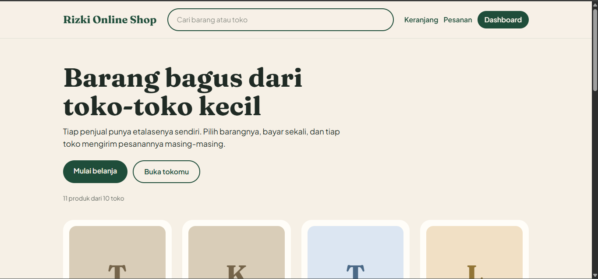
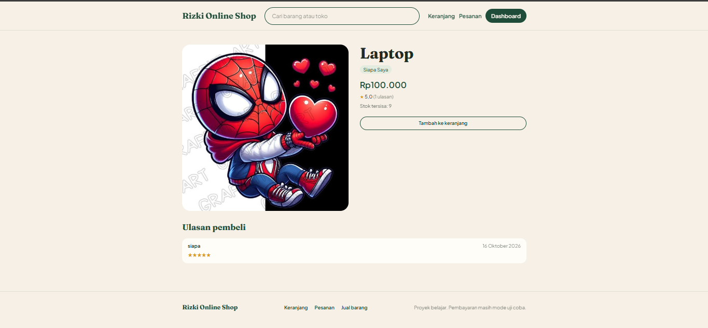
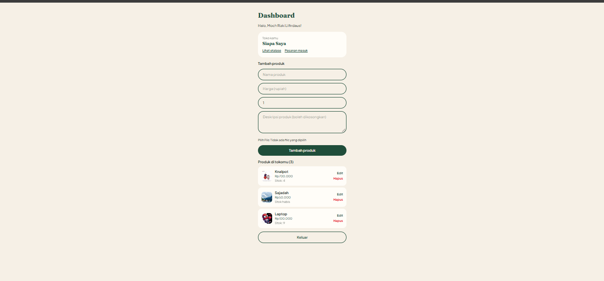

# Rizki Online Shop

Marketplace multi-penjual yang saya buat untuk belajar web fullstack. Setiap penjual membuka tokonya sendiri, pembeli bisa belanja dari beberapa toko dalam satu keranjang, dan satu kali pembayaran melunasi semuanya.

Demo: https://market-place-roan-phi.vercel.app

Pembayaran memakai Midtrans mode sandbox, jadi tidak ada uang sungguhan yang berpindah. Silakan daftar dengan email apa saja dan coba alurnya dari awal sampai akhir.

## Tampilan







## Fitur

Untuk pembeli:

- Daftar dan masuk dengan email
- Mencari produk atau toko dari kolom cari di header
- Halaman detail produk dengan foto, deskripsi, sisa stok, dan ulasan pembeli lain
- Keranjang yang mengelompokkan barang per toko, dengan jumlah yang dibatasi sesuai stok
- Checkout dengan alamat pengiriman. Pesanan otomatis dipecah per toko, tetapi pembayarannya satu kali lewat Midtrans Snap
- Halaman Pesananku dengan status yang berwarna, tombol batalkan pembayaran selama belum dibayar, dan tombol konfirmasi saat barang diterima
- Ulasan bintang dan komentar, hanya untuk barang dari pesanan yang sudah selesai

Untuk penjual:

- Buka toko dan dapat halaman etalase sendiri di `/toko/nama-toko`
- Tambah, edit, dan hapus produk, lengkap dengan foto, deskripsi, harga, dan stok
- Pesanan masuk muncul setelah pembeli membayar, lalu penjual memajukan statusnya sampai dikirim

## Alur pesanan

Saat checkout, stok langsung dikurangi dan pesanan berstatus menunggu pembayaran. Begitu pembayaran lunas, status berubah menjadi menunggu diproses dan pesanan baru terlihat oleh penjual. Penjual lalu memprosesnya sampai dikirim, dan pembeli menutupnya dengan menekan "Pesanan diterima".

Kalau pembayaran dibatalkan atau kedaluwarsa, semua pesanan dalam checkout itu dibatalkan dan stoknya dikembalikan.

Status pembayaran diperbarui dengan dua cara. Midtrans mengirim notifikasi ke `/api/midtrans/notifikasi`, dan halaman Pesananku juga menanyakan status ke Midtrans setiap kali dibuka. Cara kedua membuat alurnya tetap bisa dicoba di localhost, yang tidak bisa dijangkau oleh notifikasi dari luar. Notifikasi diperiksa tanda tangannya, dan statusnya tidak dipercaya begitu saja: server selalu bertanya ulang ke Midtrans sebelum mengubah apa pun.

## Teknologi

| Bagian | Yang dipakai |
| --- | --- |
| Framework | Next.js (App Router) dan React |
| Tampilan | Tailwind CSS, font Fraunces dan Plus Jakarta Sans |
| Database | PostgreSQL di Neon, diakses lewat Prisma |
| Login | Better Auth |
| Foto produk | Vercel Blob |
| Pembayaran | Midtrans Snap (sandbox) |
| Hosting | Vercel |

## Menjalankan di komputer sendiri

Yang dibutuhkan: Node.js, database PostgreSQL (saya pakai Neon), satu store Vercel Blob dengan akses publik, dan akun Midtrans sandbox.

```bash
git clone https://github.com/botak721/MARKET-PLACE.git
cd MARKET-PLACE/web
npm install
```

Buat file `web/.env.local` berisi:

```
DATABASE_URL=...
BETTER_AUTH_SECRET=...
BETTER_AUTH_URL=http://localhost:3000
BLOB_READ_WRITE_TOKEN=...
MIDTRANS_SERVER_KEY=...
NEXT_PUBLIC_MIDTRANS_CLIENT_KEY=...
```

Lalu buat tabel di database dan jalankan server:

```bash
npx prisma db push
npm run dev
```

Buka http://localhost:3000. Server key Midtrans bersifat rahasia dan jangan pernah di-commit.

Untuk menerima notifikasi pembayaran di situs yang sudah online, isi Payment Notification URL di dashboard Midtrans sandbox dengan `https://domain-kamu/api/midtrans/notifikasi`.

## Struktur folder

```
web/
  app/
    api/            auth, upload foto, notifikasi Midtrans
    dashboard/      dashboard penjual dan pesanan masuk
    produk/[id]/    detail produk dan ulasan
    toko/[slug]/    etalase toko
    cari/           hasil pencarian
    keranjang/ checkout/ pesanan/
  components/       kartu produk, header, form ulasan, dan lain-lain
  lib/              auth, prisma, rating, status, integrasi Midtrans
  prisma/           schema.prisma
```

## Batasan yang saya ketahui

- Pembayaran masih sandbox. Pesanan yang sudah dibayar tidak bisa dibatalkan dan belum ada pengembalian dana.
- Belum ada ongkos kirim, jadi total pesanan hanya jumlah harga barang.
- Penjual belum bisa menolak pesanan.
- Foto produk tidak ikut terhapus dari Blob saat produknya dihapus. Foto yang diganti lewat edit produk sudah dibersihkan.
- Stok yang sudah dikurangi untuk pembayaran yang tidak pernah dibuka baru dikembalikan setelah 24 jam, saat pembeli membuka halaman pesanannya lagi.

## Riwayat pengembangan

Proyek ini dikerjakan bertahap. Tiap tahap punya branch `tahap-N-...`, di-merge lewat pull request, dan diberi tag versi (`v0.1`, `v0.2`, dan seterusnya) sehingga kondisi proyek di tiap tahap bisa dibuka lagi lewat tab Tags.
